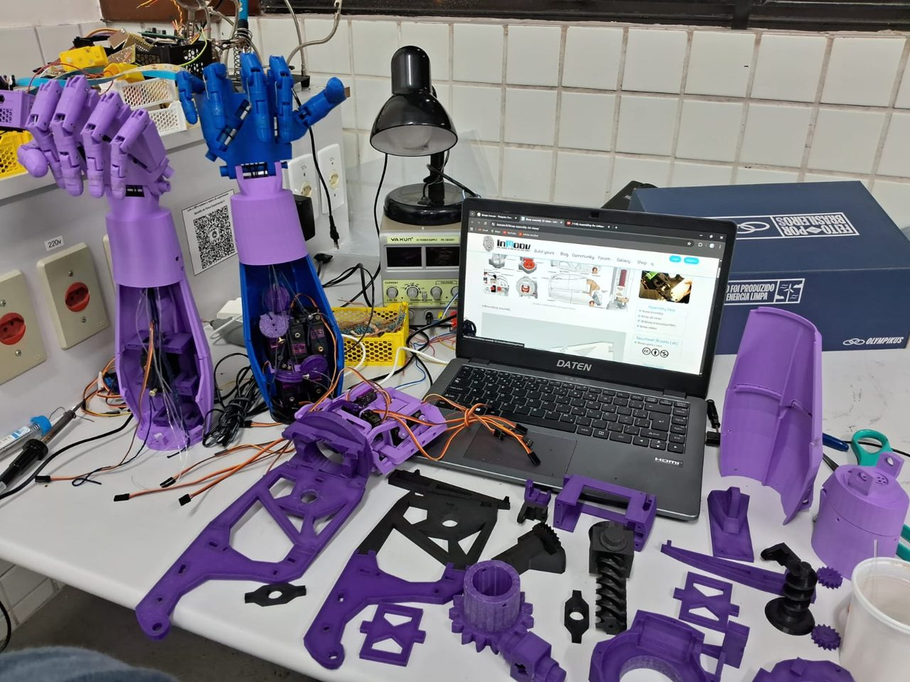
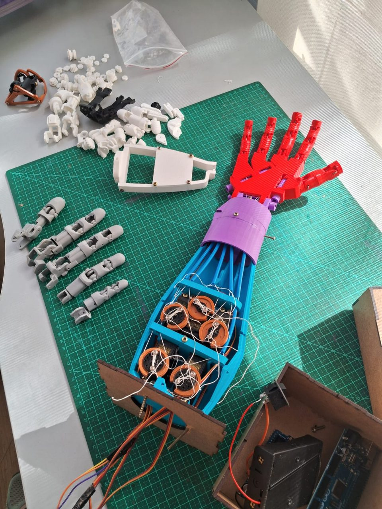
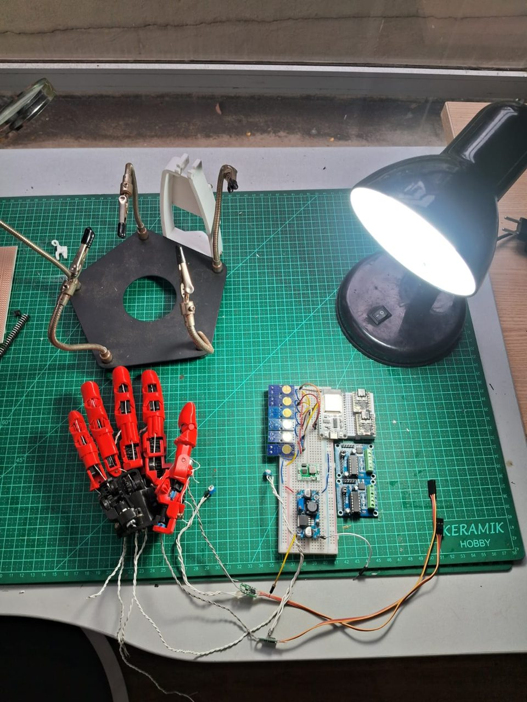
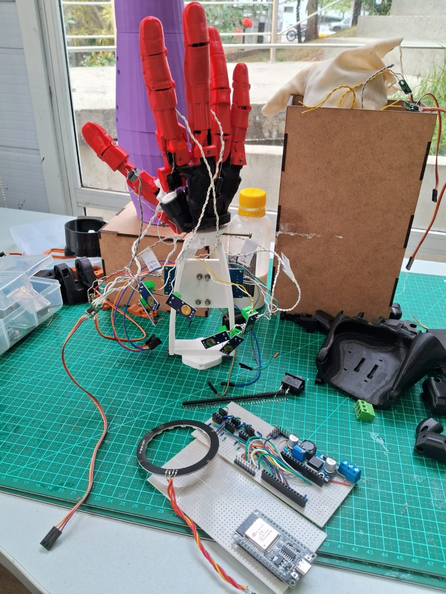

> **Em pausa** — o desenvolvimento continua no Jaspy; a mão volta mais tarde como as mãos dele. O estado daqui está congelado na tag `pausa-2026-10`.

<div align="center">

# 🦾 LimbIA

**Prótese de mão movida por EMG.**<br>
Dois eletrodos no antebraço, uma IA que aprende o músculo de quem veste, e
uma mão que para ao encostar no objeto, em vez de esmagá-lo.


<table>
  <tr>
    <td align="center" colspan="3">
      <br>
      <sub><b>As peças na bancada.</b> Mãos e antebraços impressos em 3D, os servos
      já nos encaixes e as peças soltas do próximo braço.</sub>
    </td>
  </tr>
  <tr>
    <td align="center" width="33%" valign="top">
      <br>
      <sub><b>O antebraço aberto.</b> Um servo por dedo, e as polias que puxam os
      tendões — a parte que o INOVAWEEK registrou como a mais difícil de ajustar.</sub>
    </td>
    <td align="center" width="33%" valign="top">
      <br>
      <sub><b>A mão e a eletrônica.</b> A placa e os módulos na protoboard,
      antes de irem para dentro do antebraço.</sub>
    </td>
    <td align="center" width="33%" valign="top">
      <br>
      <sub><b>A mão no suporte.</b> Montada em pé para os ensaios, com os fios
      descendo até a eletrônica.</sub>
    </td>
  </tr>
</table>

<sub>Fotos da bancada, 02/09/2026.</sub>

</div>

## Onde está

| | Situação |
| --- | --- |
| ✅ **A lógica inteira, nas duas placas** | autoteste com 89 verificações, 89 passaram nas duas (13/09) |
| ✅ **O enlace entre as placas** | conecta nos dois sentidos; 0 de 120 pacotes corrompidos aceitos |
| ✅ **EMG → rede → mão → preensão** | funcionando ponta a ponta, com sinal sintético |
| ⚠️ **Eletrodo na pele** | ensaiado com MyoWare e AD8232 (15–16/09) e **o sinal do músculo ainda não apareceu**. O AD8232 ficou preso no topo em duas placas diferentes: o defeito está no módulo, no cabo ou nos eletrodos. Ver [ramos de trabalho](#ramos-de-trabalho) |
| ⏳ **Motor ligado** | nenhum ainda — o ensaio 1 do roteiro é um dedo, um motor |
| ⏸️ **Em pausa desde 13/10/2026** | tag `pausa-2026-10`; a mão volta como as mãos do Jaspy |

Este é um projeto do laboratório [**Jaspy**](https://github.com/popliosemigod/Jaspy),
que guarda o método, as ferramentas e a documentação comum. Cada projeto tem
repositório próprio; este é o do LimbIA.

## O que ele quer ser

Uma prótese que qualquer pessoa possa vestir: o usuário calibra os próprios
eletrodos em um minuto, pela tela, e a mão passa a obedecer ao músculo dele.

1. **Calibrar por pessoa, não por prótese.** Antebraços são diferentes; a tela
   guia o posicionamento dos eletrodos até a barra ficar verde.
2. **Dois movimentos, bem feitos:** mão aberta e mão fechada — sem tremor, sem
   resposta errática, com velocidade estável.
3. **Fechar parando no contato**, em vez de esmagar o objeto até a pose gravada.
4. **Manutenção sem cabo:** as duas placas se gravam pela rede da própria prótese.

A ideia que junta tudo, herdada da fusão do INOVAWEEK com o LAD
([`docs/01`](docs/01-heranca-inovaweek-e-lad.md)): **o servo sabe onde o dedo
está e não mede força; o sensor de corrente mede força e não sabe onde o dedo
está. O LimbIA usa os dois.**

## Duas placas

```
   ESP32-C3 SuperMini                 ESP32 DevKit V1
   placa do EMG                       placa da mão
   2 eletrodos a 1 kHz                4 motores DC (2× L293D)
   filtros, IA e decisor   ──UDP──►   2 servos no polegar
   rede, tela e OTA        ◄──────    6 ACS712
   192.168.4.1             telemetria 192.168.4.200
```

O PC ou o celular entra na rede da prótese e a tela de ajuste abre sozinha.

## Registros

Autoteste rodando **nas placas** (13/09/2026):

| | DevKit V1 | ESP32-C3 |
| --- | --- | --- |
| Tempo do banco | 44,1 s | 209,5 s (banco reduzido) |
| Cadeia de filtros do EMG | 0,90 µs/amostra | 22,65 µs/amostra |
| Dois canais a 1 kHz | 0,2% de um núcleo | **4,5% de um núcleo** |
| Classificação LDA | 2,99 µs | 30,33 µs |
| Flash | 64,8% | 66,1% |

Com as duas placas ligadas:

| | |
| --- | --- |
| Janelas de EMG no C3, com rede e tela no ar | **1045, perdidas 0** |
| Enlace entre as placas | conecta nos dois sentidos |
| Comando EMG → rede → mão → preensão | funcionando |
| Pacotes com 1 bit trocado aceitos | 0 de 120 |
| Calibração de eletrodo (sinal sintético) | verde em 3 ciclos (~37 s) |
| Eletrodo no tendão, trocado, saturando, mau contato | recusados, com diagnóstico |
| Modelo recusado pela tela, usado à força | 0 de 30 intenções, nenhuma ação errada |

Cada iteração, com previsto ao lado de medido, está no [diário](diario.md).

## Ramos de trabalho

Dois trabalhos ficaram em ramo próprio, fora da `main`, porque ainda não
passaram pela bancada até o fim. Estão publicados para não depender de uma
máquina só.

| Ramo | O que tem | Resultado |
| --- | --- | --- |
| [`feat/ensaio-emg-gpio4`](https://github.com/popliosemigod/LimbIA/tree/feat/ensaio-emg-gpio4) | Firmware de teste do EMG com um eletrodo no GPIO4 do C3: captura crua de 1 s e espectro no PC, leitura de eletrodo solto do AD8232 (LO+/LO−), passa-altas alternável entre 20 e 8 Hz, e o teste base do AD8232 num Arduino, fora da cadeia. 8 commits, 15–16/09 | **O defeito está antes do firmware.** Com o AD8232, a saída fica **presa no topo, ~3,2 V**: no ESP32 e de novo num Arduino com o código do fabricante. Falta trocar módulo, cabo ou eletrodos. (Sem sensor, o GPIO4 solto dá 99,8% da potência em 60 Hz — a assinatura de pino solto, guardada como referência) |
| [`feat/mao-5-servos-gestos`](https://github.com/popliosemigod/LimbIA/tree/feat/mao-5-servos-gestos) | A mão antiga de **5 servos, um por dedo, num Arduino Mega**: dez gestos por botão (números, paz, joinha, rock...) e a serial já pronta para a visão computacional do `cvzone`. Projeto separado, em `legado/mao-5-servos`. 3 commits, 21–22/09 | Curso reduzido a 0–90° até a mecânica ser calibrada. É o ponto de partida mais próximo das mãos de servo do Jaspy |

## Compilar e gravar

```powershell
pio run                          # mão, EMG e autoteste

pio run -e esp32dev -t upload    # a mão      (sempre com -e)
pio run -e emg      -t upload    # o EMG
pio device monitor -b 115200     # console

pio run -e mao_ota -t upload     # pela rede, sem USB
pio run -e emg_ota -t upload
```

| Ambiente | Placa | Para que serve |
| --- | --- | --- |
| `esp32dev` | DevKit V1 | a mão (motores DC do LAD) |
| `emg` | ESP32-C3 | EMG, IA, rede e tela |
| `mao_servo` | DevKit V1 | a mão na variante de servos + PCA9685 |
| `bancada` | DevKit V1 | a mão com log detalhado |
| `autoteste` / `autoteste_c3` | as duas | a lógica sem hardware |
| `mao_ota` / `emg_ota` | as duas | gravação pela rede |

## Documentação

| | |
| --- | --- |
| [01](docs/01-heranca-inovaweek-e-lad.md) | de onde o projeto veio: INOVAWEEK e LAD |
| [02](docs/02-hardware-e-pinagem.md) | hardware e pinagem |
| [03](docs/03-anatomia-gestos-e-calibracao.md) | juntas, gestos e calibração |
| [04](docs/04-propriocepcao.md) | como a mão descobre a forma do objeto |
| [05](docs/05-emg-e-a-ia.md) | o EMG, a calibração por pessoa e a IA |
| [06](docs/06-rede-tela-e-ota.md) | a rede, a tela e o OTA |
| [07](docs/07-roteiro-de-bancada.md) | **roteiro de ensaios**, com as previsões |

## O que falta — a fase de ensaios

O roteiro dos seis ensaios, com as previsões escritas antes de medir, está em
[`docs/07-roteiro-de-bancada.md`](docs/07-roteiro-de-bancada.md).

1. Um dedo se movendo, com cadência controlada.
2. O mesmo dedo com ACS712 — de onde saem os três limiares de corrente.
3. A mão inteira, e o primeiro acerto de campo do classificador de preensão.
4. O primeiro eletrodo na pele com sinal — o que o ramo de ensaio do EMG ainda não conseguiu.
5. A prótese em uso.
6. Gravação pela rede.

Depois disso, a órtese — que dá metade do nome ao projeto.

## Crédito

**LAD Robotic Hand V3.0 — ESP32 Control v1.1**, de **Adrian Duran** (LAD
Robotics): a mão, os motores, os sensores de corrente em série, a calibração por
endpoints medidos e o polegar com dois graus de liberdade.

Projeto do laboratório [Jaspy](https://github.com/popliosemigod/Jaspy).
