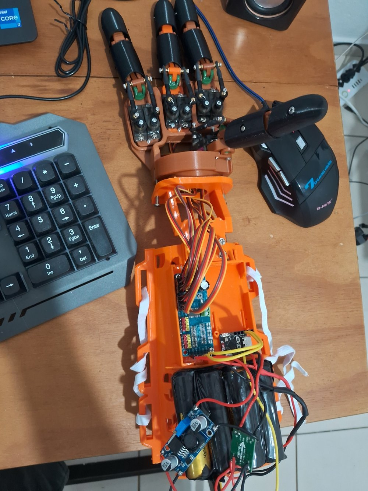

<div align="center">

# 🦾 LimbIA

**Mão robótica movida pelo músculo.**<br>
Uma Amazing Hand impressa em 3D, oito MG90S e um sensor de EMG numa
ESP32-C3. Contraiu uma vez, a mão fecha; contraiu de novo, abre.


<br>
<sub><b>A mão na bancada, 17/11/2026.</b> Quatro dedos com dois MG90S cada; no
antebraço, o PCA9685 com os oito servos, a ESP32-C3 SuperMini, as baterias e o
regulador que dá os 5 V dos servos.</sub>

</div>

## Onde está

| | Situação |
| --- | --- |
| ✅ **A mão se move pela página** | 17/11, depois de ligar os 5 V no V+ do PCA9685. Relato da bancada: ângulos ainda não medidos |
| ✅ **A lógica, na placa** | autoteste na C3: **132 de 132** (regra dos dois servos, filtro, detector, calibração) |
| ✅ **Página sem internet** | rede aberta `LimbIA-mao`, portal cativo; gráfico, calibração, 8 sliders, CSV |
| ✅ **Filtro do EMG** | contração reconhecida em **86 ms**; rede de 120 pp e espigões de 2500 não tiram o repouso do lugar; **50,7 µs** por amostra (5% da C3) |
| ⏳ **Calibração mecânica** | sentido de cada par A/B, centro de cada servo, curso até 90° |
| ⏳ **Músculo comandando a mão** | MyoWare lido na placa, mas ainda sem ensaio na pele com a mão ligada |

Cada iteração, com o previsto ao lado do medido, está no [diário](diario.md).

## Como funciona

```text
 MyoWare ──GPIO3──►  ESP32-C3 SuperMini  ──I2C (GPIO6/7)──►  PCA9685  ──►  8× MG90S
  (antebraço)         filtro, detector,                        ▲           (2 por dedo)
                      calibração, Wi-Fi                        │
                            │                           5 V externos no V+
                            ▼
                 celular em "LimbIA-mao" → 192.168.4.1
```

**Dois servos por dedo.** Cada dedo da Amazing Hand é um mecanismo paralelo:
os dois servos girando em sentidos **opostos** fletem o dedo; girando no
**mesmo** sentido, abrem o dedo para o lado. Mandar o mesmo ângulo para os dois
torce o dedo em vez de fechá-lo. A regra, deduzida dos gestos oficiais e
conferida no autoteste:

```text
servo A = centro + flexão + abdução
servo B = centro − flexão + abdução
```

**O músculo alterna a mão.** Só a subida da contração troca o estado, com
800 ms de refratário. Segurar a contração não abre e fecha de novo.

**Filtro próprio, sem mexer no hardware:**

1. Hampel contra espigão de mau contato.
2. Notch de 60 e 120 Hz contra a rede.
3. Envelope lento (nível) e rápido (duração).
4. Histerese e 80 ms contínuos para valer.
5. Teto de artefato: uma pancada no eletrodo não conta como contração.

**O músculo só comanda depois de calibrar.** No boot os servos ficam soltos e
o EMG não move nada. A calibração pede "contraia" e "relaxe" até ter três
contrações boas e consistentes, calcula os limiares e faz uma **prova** com
mais três contrações, julgadas pelo mesmo detector que vai mover a mão. Só
então libera, e a mão vai ao **auto-home** (mão aberta). O caminho mais curto
leva ~37 s.

**O desenvolvedor move sempre.** Pela página ou pelo console, servo a servo
ou a mão inteira, a 30°/s, mesmo com o músculo travado.

## Ligação

| ESP32-C3 SuperMini | Vai para |
| --- | --- |
| GPIO6 | PCA9685 SDA |
| GPIO7 | PCA9685 SCL |
| GPIO3 (ADC1) | MyoWare SIG |
| 3V3 | PCA9685 VCC e MyoWare +Vs |
| GND | PCA9685, MyoWare e GND da fonte de 5 V |

| Canais do PCA9685 | Dedo |
| --- | --- |
| 0, 1 | indicador A, B |
| 2, 3 | médio A, B |
| 4, 5 | anelar A, B |
| 6, 7 | polegar A, B |

**O V+ do PCA9685 precisa de 5 V externos**, de pelo menos 5 A, com o GND
comum. O 3V3 da C3 não move servo nenhum, e foi isso que segurou a mão parada
até 17/11.

## A página

1. Ligue a mão.
2. No celular, entre na rede **`LimbIA-mao`** (aberta, sem senha).
3. A página abre sozinha. Se não abrir, digite **192.168.4.1**.

Sem internet, sem roteador, sem aplicativo. Nela ficam:

- a faixa **MÚSCULO TRAVADO/LIBERADO**;
- a lâmpada de **CONTRAÇÃO** e o gráfico do sinal com as linhas de disparo;
- a calibração guiada;
- Abrir mão, Fechar mão e Auto-home;
- os 8 servos um a um;
- a captura da leitura em CSV.

## Compilar e gravar

```powershell
pio run -e amazing_c3 -t upload   # grava a C3
pio device monitor -b 115200      # console: ? mostra os comandos
pio run -e autoteste_c3 -t upload # autoteste da lógica, sem hardware
```

Na USB sai também o Serial Plotter, a 50 linhas por segundo.

## Documentação

- [**08 — Amazing Hand**](docs/08-amazing-hand.md): tudo desta versão, com a
  pinagem completa, o filtro, a calibração, a página, o console e o roteiro do
  primeiro ensaio.
- [Diário](diario.md): cada passo, com previsto e medido.

## De onde veio

O LimbIA começou como a fusão do braço **INOVAWEEK**, do laboratório, com a
**LAD Robotic Hand V3.0**, de Adrian Duran (LAD Robotics): motores DC, sensores
de corrente e duas placas. Essa versão continua compilando
(`esp32dev`, `emg`) e está registrada em [docs/01 a 07](docs/01-heranca-inovaweek-e-lad.md)
e na tag `pausa-2026-10`. Do caminho ficaram a calibração por pessoa, o
autoteste que mede a lógica sem hardware e a regra de que o modo de falha
seguro é a mão parada.

## Crédito

**Amazing Hand**, da [Pollen Robotics](https://github.com/pollen-robotics/AmazingHand)
(Apache-2.0): a mão e o mecanismo paralelo dos dedos. **MyoWare**: o sensor de
EMG.

Projeto do laboratório [Jaspy](https://github.com/popliosemigod/Jaspy).
